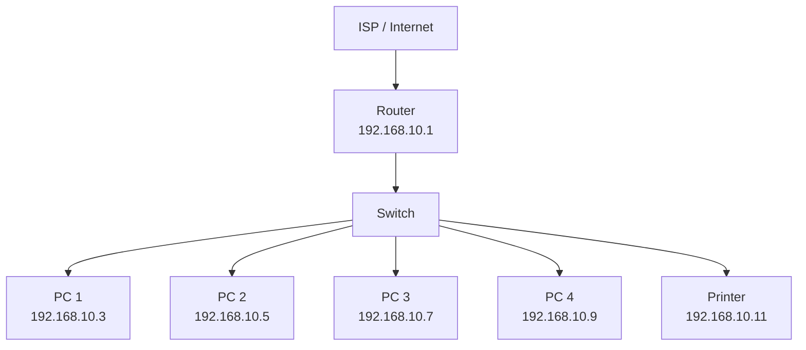

# CC 101 – Introduction to Computing

## "Know Your Network Settings": Exploring Windows 11 Network Configuration Tools

**Sorsogon State University** – College of Information and Communications Technology, Bulan Campus
Zone 8, Bulan, Sorsogon | Tel. No.: 056 311-0103 | Email: cict@sorsu.edu.ph

| | |
|---|---|
| **Name** | Mart Sid D. De Venecia |
| **Block** | BSCS 1-1 |
| **Computer Unit Used (Desktop/Laptop, brand)** | Laptop, Lenovo |
| **Date** | October 18, 2026 |

---

## I. Objectives

At the end of this activity, you should be able to:

- Locate network adapter information using Windows 11 Settings, the Control Panel, Command Prompt (CMD), and PowerShell.
- Use `ipconfig`, `getmac`, `hostname`, `ping`, `netstat`, `route print`, and `systeminfo` in CMD, and `Get-NetAdapter`, `Get-NetIPAddress`, and `Test-Connection` in PowerShell.
- Interpret a sample `ipconfig /all` output from a networked computer: identify its IP address, subnet mask, default gateway, and DNS servers, and classify the address as public or private.
- Relate each tool and finding to the layer of the OSI model where it works.
- Design a simple network and IP address plan for the computer laboratory.

## II. Materials Needed

- A computer running Windows 11 (a network or Internet connection is **not** required for this activity)
- This worksheet (printed copy, or the digital file to fill out and submit)
- Week 6 lecture notes, for reference on IP addresses, protocols, the OSI model, and network devices

## III. Background

A computer does not need to be connected to a network to have network settings. Every PC has one or more **network adapters** (NICs), each with a permanent **MAC address**, and Windows always runs the TCP/IP software, including the **loopback** address 127.0.0.1 (IPv4) and ::1 (IPv6) that the computer uses to talk to itself. Windows 11 lets you inspect these settings in four places: the **Settings** app, the classic **Control Panel**, **Command Prompt (CMD)**, and **PowerShell**. In this activity, you will explore all four on your own unit, observe how Windows behaves when no network is available, and then analyze a sample configuration taken from a computer that *is* connected to a network.

## IV. Procedure

> **Reminder:** This is a *viewing* activity. Do not change, disable, or reset any network setting. Close every dialog with **Cancel**. Record values exactly as Windows shows them.

### Part A – Windows 11 Settings

1. Press **Windows + I** to open Settings, then click **Network & internet**. Write down the connection status shown at the top of the page (for example, "Not connected").
   - **Answer:** *Connected, secured*
2. Click **Advanced network settings**. Under **Network adapters**, note every adapter listed (for example, Ethernet, Wi-Fi, Bluetooth Network Connection) and whether each one is enabled or disconnected.
   - **Answer:** *Wi-Fi, Enabled*
3. Scroll down and click **Hardware and connection properties**. For each adapter, record its **Name**, **Description**, **Physical address (MAC)**, and **Status** in **Table 1**.

### Part B – Control Panel (Network Connections)

4. Press **Windows + R**, type `ncpa.cpl`, and press **Enter**. This opens the classic **Network Connections** window. A red X on an icon means the adapter has no network connection.
5. Right-click your **Ethernet** adapter and choose **Properties**. List the items checked under "This connection uses the following items" in **Table 2**.
6. Select **Internet Protocol Version 4 (TCP/IPv4)** and click **Properties**. Record whether the computer is set to **Obtain an IP address automatically** (DHCP) or **Use the following IP address** (static), and the same for DNS. Click **Cancel**, then **Cancel** again. Do not change anything.

### Part C – Command Prompt (CMD)

7. Press the **Windows key**, type `cmd`, and press **Enter**. Run each command below, one at a time, and record the results in **Table 3**.

   ```
   hostname
   getmac /v
   ipconfig /all
   ```

   > **Tip:** For a disconnected adapter, `ipconfig /all` shows "Media disconnected" and no IPv4 address, but it still shows the Description and Physical Address.

8. Test the computer's own TCP/IP software using the loopback address. Record whether you got replies and the time. For `ping localhost`, note the address that replied.

   ```
   ping 127.0.0.1
   ping localhost
   ```

9. Now observe what happens when there is no network. Record the **exact** message each command displays.

   ```
   ping 8.8.8.8
   nslookup google.com
   ```

10. View the ports your computer is listening on and its routing table. In Table 3, record three LISTENING local addresses with their port numbers, and the Netmask shown for the Network Destination 127.0.0.0.

    ```
    netstat -an | findstr LISTENING
    route print -4
    ```

11. Run the command below. It may take a few seconds. Scroll to **Network Card(s)** and record how many network cards are installed and the status of each.

    ```
    systeminfo
    ```

### Part D – PowerShell

12. Right-click the **Start** button and choose **Terminal** (or press the **Windows key**, type `PowerShell`, and press **Enter**). Run each command below and record the results in **Table 4**.

    ```powershell
    Get-NetAdapter
    Get-NetIPAddress -AddressFamily IPv4 | Format-Table InterfaceAlias, IPAddress, PrefixLength
    Test-Connection 127.0.0.1 -Count 4
    Get-NetTCPConnection -State Listen | Select-Object -First 5 LocalAddress, LocalPort
    ```

    > **Tip:** PowerShell commands follow a Verb-Noun pattern (`Get-NetAdapter` = "get the network adapters"). Compare each result with the matching CMD command from Part C.

### Part E – Analyze a Networked Computer

13. The output below was taken from a laboratory computer that **is** connected to a network. Study it, then complete **Table 5**.

**Sample Output 1. `ipconfig /all` (excerpt) from a networked PC**

```
Host Name . . . . . . . . . . . : CICT-LAB-PC07

Ethernet adapter Ethernet:

   Description . . . . . . . . . : Realtek PCIe GbE Family Controller
   Physical Address. . . . . . . : 3C-52-82-A1-7F-09
   DHCP Enabled. . . . . . . . . : Yes
   Link-local IPv6 Address . . . : fe80::8c2d:4a1f:93b2:61e5%12(Preferred)
   IPv4 Address. . . . . . . . . : 192.168.10.37(Preferred)
   Subnet Mask . . . . . . . . . : 255.255.255.0
   Lease Obtained. . . . . . . . : Wednesday, October 14, 2026 8:02:15 AM
   Lease Expires . . . . . . . . : Thursday, October 15, 2026 8:02:15 AM
   Default Gateway . . . . . . . : 192.168.10.1
   DHCP Server . . . . . . . . . : 192.168.10.1
   DNS Servers . . . . . . . . . : 192.168.10.1, 8.8.8.8
```

### Part F – Design a Network for Our Laboratory

14. Our laboratory does not yet have a network. In the box after Table 5, draw a simple **star topology** network for it. Include at least **four PCs**, one **switch**, one **router** (default gateway), one **printer**, and the **ISP / Internet**. Use lines to show connections.
15. Assign each device a private IPv4 address from the network **192.168.10.0/24**, using **192.168.10.1** for the router. Label each device in your drawing and complete the **IP Address Plan** (Table 6).

### Part G – Optional / Bonus

16. In CMD, run `type C:\Windows\System32\drivers\etc\hosts` to *view* (not edit) the hosts file. In one or two sentences, explain what this file is for and how it relates to DNS.

---

## V. Data and Findings

### Table 1. Network Adapters in Settings (Part A)

**Connection status shown on the Network & internet page:** Connected, secured

| Adapter Name | Description | Physical Address (MAC) | Status |
|---|---|---|---|
| Wi-Fi | Intel(R) Wi-Fi 6 AX201 160MHz | C0:A5:E8:55:49:DE | Enabled |

### Table 2. Adapter Properties (Part B)

| Items Checked Under "This connection uses the following items" | Item Checked (continued) |
|---|---|
| Client for Microsoft Networks | |
| File and Printer Sharing for Microsoft Networks | |
| QoS Packet Scheduler | |
| Bridge Driver | |
| Nested Network Visualization | |
| Internet Protocol Version 4 (TCP/IPv4) | |
| Microsoft LLDP Protocol Driver | |
| Internet Protocol Version 6 | |
| Link-Layer Topology Discovery Responder | |
| Link-Layer Topology Discovery Mapper I/O Driver | |

| TCP/IPv4 Setting | Automatic or Static? |
|---|---|
| IP address | Automatic |
| DNS server address | Automatic |

### Table 3. Command Prompt Results (Part C)

| Command / Item | Your Findings | OSI Layer |
|---|---|---|
| `hostname` | ATOMIC | Layer 7 |
| `getmac /v`: MAC address and Transport Name | C0-A5-E8-55-49-DE and `Device\Tcpip_{E06637CC-049B-4AD9-AE60-9BDF09949A1E}` | Layer 2 |
| `ipconfig /all`: Media State of Ethernet | Media disconnected | — |
| `ipconfig /all`: DHCP Enabled | Yes | — |
| `ping 127.0.0.1`: replies and time | Replies: 4, Time: Less than 1 ms | Layer 3 |
| `ping localhost`: address that replied | ::1 | — |
| `ping 8.8.8.8`: exact message | See output below | Layer 3 |
| `nslookup google.com`: exact message | See output below | Layer 7 |
| `netstat -an`: three LISTENING addresses:ports | See output below | Layer 4 |
| `route print -4`: Netmask for 127.0.0.0 | 255.0.0.0 | — |
| `systeminfo`: number of NICs and status | 1 NIC, Installed and connected to the Wi-Fi Network | — |

**`ping 8.8.8.8`**

```
Pinging 8.8.8.8 with 32 bytes of data:
Reply from 8.8.8.8: bytes=32 time=32ms TTL=115
Reply from 8.8.8.8: bytes=32 time=39ms TTL=115
Reply from 8.8.8.8: bytes=32 time=86ms TTL=115
Reply from 8.8.8.8: bytes=32 time=45ms TTL=115

Ping statistics for 8.8.8.8:
    Packets: Sent = 4, Received = 4, Lost = 0 (0% loss),
Approximate round trip times in milli-seconds:
    Minimum = 32ms, Maximum = 86ms, Average = 50ms
```

**`nslookup google.com`**

```
Server:  UnKnown
Address:  192.168.0.1

Non-authoritative answer:
Name:    google.com
Addresses:  2404:6800:4017:806::200e
            142.251.34.142
```

**`netstat -an`**

```
Proto  Local Address     Foreign Address   State
TCP    0.0.0.0:135       0.0.0.0:0         LISTENING
TCP    0.0.0.0:445       0.0.0.0:0         LISTENING
TCP    0.0.0.0:5040      0.0.0.0:0         LISTENING
```

### Table 4. PowerShell Results (Part D)

| Command | What It Showed | Matches CMD? (Y/N) |
|---|---|---|
| `Get-NetAdapter`: Name, Status, MacAddress, LinkSpeed | Wi-Fi, Intel(R) Wi-Fi 6 AX201 160MHz, 16 Up | N |
| `Get-NetIPAddress`: IPv4 addresses and PrefixLength | See output below | N |
| `Test-Connection 127.0.0.1`: result | See output below | N |
| `Get-NetTCPConnection -State Listen`: two LocalAddress:LocalPort pairs | See output below | N |

**`Get-NetIPAddress`**

| Interface | IPv4 Address | PrefixLength |
|---|---|---|
| Local Area Connection* 2 | 169.254.165.183 | 16 |
| Local Area Connection* 1 | 169.254.30.0 | 16 |
| Wi-Fi | 192.168.0.188 | 24 |
| Loopback Pseudo-Interface 1 | 127.0.0.1 | 8 |

**`Test-Connection 127.0.0.1`**

```
Source  Destination  IPV4Address    IPV6Address
------  -----------  -----------    -----------
ATOMIC  127.0.0.1    192.168.0.188  fe80::83f:47d:d167:3d3f%16
ATOMIC  127.0.0.1    192.168.0.188  fe80::83f:47d:d167:3d3f%16
ATOMIC  127.0.0.1    192.168.0.188  fe80::83f:47d:d167:3d3f%16
ATOMIC  127.0.0.1    192.168.0.188  fe80::83f:47d:d167:3d3f%16
```

**`Get-NetTCPConnection -State Listen`**

```
LocalAddress  LocalPort
------------  ---------
::            49694
::1           49683
::            49680
::            49679
::            49668
```

### Table 5. Sample Output Analysis (Part E)

| Question | Your Answer |
|---|---|
| IPv4 address of PC07 | 192.168.10.37 (Preferred) |
| Subnet mask (and its /prefix) | 255.255.255.0 |
| Default gateway, and what device it usually is | 192.168.10.1 |
| DNS servers | 192.168.10.1, 8.8.8.8 |
| Was the address assigned by DHCP or set manually? How do you know? | It was assigned by DHCP. I know because DHCP Enabled is set to "Yes" and it shows a DHCP Server address. |
| Public or private? Which RFC 1918 range? | It is a private IP address. It falls under the 192.168.0.0/16 RFC 1918 range (specifically, 192.168.10.37). |
| IPv4 address of PC07 in binary (four octets) | `11000000.10101000.00001010.00100101` |
| MAC address, and the OSI layer where it is used | 3C-52-82-A1-7F-09, and it is used in OSI Layer 2, which is the Data Link Layer. |
| How long is the DHCP lease? | 24 hours |
| If the DHCP server failed, what kind of address would PC07 assign itself? | An APIPA address (Automatic Private IP Addressing) / link-local IPv4 address in the 169.254.x.x range. |

### Figure 1. Proposed Laboratory Network Diagram (Part F)



### Table 6. IP Address Plan (Part F)

| Device | IPv4 Address | Subnet Mask | Default Gateway |
|---|---|---|---|
| Router (gateway) | 192.168.10.1 | 255.255.255.0 | — |
| PC 1 | 192.168.10.3 | 255.255.255.0 | 192.168.10.1 |
| PC 2 | 192.168.10.5 | 255.255.255.0 | 192.168.10.1 |
| PC 3 | 192.168.10.7 | 255.255.255.0 | 192.168.10.1 |
| PC 4 | 192.168.10.9 | 255.255.255.0 | 192.168.10.1 |
| Printer | 192.168.10.11 | 255.255.255.0 | 192.168.10.1 |

### Part G Notes (Optional / Bonus)

*(left blank)*

---

## VI. Realization (Reflection)

*In two to four sentences each, answer the following in your own words.*

**1. Even without a network connection, what network information did your computer still have? Why do you think it still has it?**

Even without an active network connection, my laptop still retained local network information such as my loopback address (127.0.0.1), physical MAC addresses, and link-local APIPA addresses (169.254.x.x). I keep this information because it is permanently stored on my hardware network interface card and hardcoded into my operating system's network stack to allow internal diagnostics and self-communication.

**2. Compare Settings, Control Panel, CMD, and PowerShell. Which tool did you find most useful for viewing network information, and why?**

For me, the tool that I find the most useful is the CMD. I find it the most useful because through the CMD, we are able to view almost all the information a PC or a laptop has, just by running a specific command.

**3. What did the messages from `ping 8.8.8.8` and `nslookup google.com` tell you? How would you use messages like these when troubleshooting a real network?**

When I ran `ping 8.8.8.8`, it verified my basic IP-level connectivity by showing whether my packets could reach a public server and return. When I ran `nslookup google.com`, it confirmed whether my DNS servers could properly translate domain names into IP addresses. In real network troubleshooting, I would use `ping` to test connection reachability and `nslookup` to diagnose name-resolution failures.

**4. Why should you be careful about sharing your MAC address, IP address, or `ipconfig /all` screenshots online? Relate your answer to data privacy.**

Sharing my MAC and IP addresses online compromises my data privacy by revealing my hardware identity, network setup, and approximate location to potential attackers. This exposure allows malicious actors to track my device, map my local network, or target my system with specific exploits.

---

## VII. Scoring Guide

| Criteria | Description | Points |
|---|---|---|
| Completeness | All tables (1–6) and required fields are filled out. | 25 |
| Accuracy | Recorded values match what the tools show and are consistent across Settings, CMD, and PowerShell; sample analysis, binary conversion, and OSI layers are correct. | 30 |
| Network Design | Diagram shows a star topology with PCs, switch, router, printer, and ISP; IP plan uses valid, non-duplicate addresses in 192.168.10.0/24. | 15 |
| Realization / Reflection | Answers are thoughtful, based on the student's own results, and well written. | 20 |
| Neatness & Timeliness | Worksheet is legible/well-formatted and submitted on time. | 10 |
| **Total** | | **100** |
